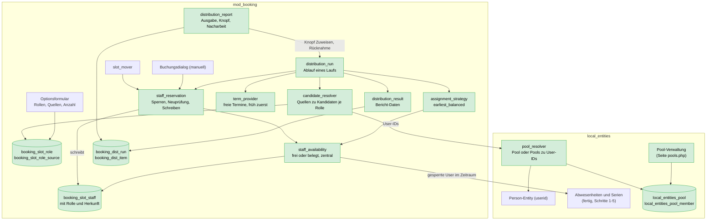
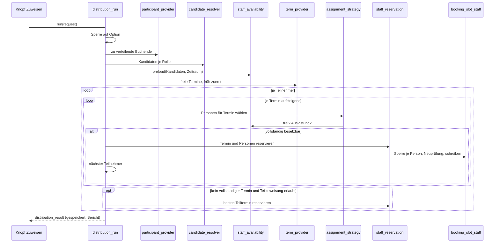

# Prüfer- und Protokollanten-Verteilung — Finale Architektur

> **Stand:** 2026-10-19, Entwurf. F1–F4 sind von Georg bestätigt (2026-10-19). Die übrigen Punkte mit **[Frage]**
> sind Vorschläge von Claude und werden vor dem Bau bestätigt (Abschnitt 12).
> **Grundlage:** Konzept „Automatisierte Zuweisung von Prüfern und Protokollanten in Moodle Booking" (IQSH).
> **Baut auf:** `EXAMINER_ENTITIES_ARCHITECTURE_2026-10-13.md` (gleicher Ordner) (Personen und
> Abwesenheiten in Entities, Schritte 1–5 fertig) und dem zugehörigen Umsetzungsplan.
> **Dieses Dokument ersetzt** die Abschnitte der alten Architektur zu Verteilung (`examiner_distributor`,
> `teacher_pool`, `teachers_required`) und erweitert sie um Rollen, Pools, Bericht und Nebenläufigkeit. Alles
> andere (Personen, Abwesenheiten, Rechte, Datenschutz) gilt unverändert.

---

## 1. Ziel in einem Satz

Eine Buchungsoption (= eine Prüfung) kennt Kandidaten für die Rollen **Prüfer** und **Protokollant**. Auf Knopfdruck
werden die Buchenden auf die frühestmöglichen Prüfungstermine verteilt und je Termin die benötigten Personen
zugewiesen, ohne Zeitüberschneidungen, ohne doppelte Rolle im selben Termin und möglichst gleichmäßig
ausgelastet. Was nicht geht, wird markiert und berichtet, der Lauf bricht nie ab.

## 2. Antworten auf die offenen technischen Fragen des Konzepts

| # | Frage des Konzepts | Antwort |
|---|---|---|
| 1 | Entities-Kategorien als Pools? | **Nein.** Die „Kategorien" in Entities sind Kategorien für Zusatzfelder (Custom-Field-Handler), keine Gruppen von Entities. Es gibt dort nichts, was Personen gruppiert. Eigene **Pools in Entities** (Abschnitt 4). |
| 2 | Verknüpfung Prüfer/Protokollant ↔ Option und Termin | Option: Quellen und Anzahl je Rolle (Abschnitt 5). Termin: `booking_slot_staff` mit Rolle (Abschnitt 6). |
| 3 | Wo liegen die Zuweisungen? | `booking_slot_staff` (eine Zeile je Person, Rolle und gebuchtem Termin), dazu `booking_dist_run` und `booking_dist_item` für den Bericht. |
| 4 | Überschneidungen zuverlässig erkennen | Eine zentrale Klasse `staff_availability` fragt (a) Abwesenheiten in Entities und (b) `booking_slot_staff` über **alle** Optionen und beide Rollen ab. Keine JSON-Suche mehr. |
| 5 | Parallele Läufe | Sperren pro Person (Moodle `lock_factory`) und Neuprüfung in der Transaktion, gleicher Weg für manuelle Buchung und Verteilung (Abschnitt 9). |
| 6 | Erneuter Lauf | Manuelle Zuweisungen bleiben immer. Standard ist **Ergänzen**: nur Offenes wird bearbeitet. **Neu verteilen** löscht nur automatische Zuweisungen, mit Rückfrage (Abschnitt 8.4). |
| 7 | Entwurf oder direkt übernehmen | **Direkt übernehmen**, dafür ist jeder Lauf im Bericht gespeichert und als Ganzes **zurücknehmbar** (Abschnitt 8.5). **[Frage F3]** |

## 3. Gesamtbild

Grundregel wie bisher: **Booking sieht nur Moodle-User-IDs, nie Entity-IDs.** Entities kennt Personen,
Abwesenheiten und Pools. Die Verteilung, ihre Regeln und alle Zuweisungen gehören Booking.

## 4. Pools (Entities)

**Entscheidung:** Pools sind ein eigenes, kleines Konzept in `local_entities`. Sie gruppieren Personen-Entities,
unabhängig von Rolle und Fach.

### Warum in Entities und nicht in Booking

- Personen liegen dort. Wer Personen pflegt, pflegt auch deren Gruppen.
- Ein Pool „Prüfer Griechisch" ist über mehrere Buchungsinstanzen und Optionen wiederverwendbar.
- Booking bleibt bei User-IDs und braucht nur eine Auflösung Pool → User-IDs.

### Warum nicht Moodle-Kohorten **[Frage F1]**

Kohorten wären ohne Bau nutzbar (Verwaltung, Massenimport, Rechte sind da). Dagegen spricht: Mitglieder wären
Benutzer, nicht Personen; Abwesenheiten und Pools wären in zwei Welten gepflegt; ohne Plugin Entities gäbe es
keinen Unterschied zwischen Prüfer-Gruppen und beliebigen Kohorten. Falls Georg schnellen Nutzen vor sauberem
Modell will, ist Kohorten-Anbindung eine **zweite Quelle** im `candidate_resolver` (Abschnitt 5) und kann später
nachgerüstet werden, ohne das Modell zu ändern.

### Pool-Typ (Stand 2026-10-20)

Ein Pool hat einen **Typ: den Entity-Typ seiner Mitglieder** (`local_entities_pool.pooltype`, heute nur `person`;
später z. B. `equipment` für Fahrzeuge oder `location` für Räume). Ein Pool vom Typ `person` enthält nur Personen.
Der Typ lässt sich nach dem Anlegen nicht ändern. Mitglieder werden als Entity-ID gespeichert. Booking bekommt über
die Fassade weiter nur User-IDs, und zwar aus Pools vom Typ `person`. Die Oberfläche ist ein eigener Tab „Pools"
im Entity Manager (nicht in der Liste der Entities, weil ein Pool eine Gruppierung ist und keine Entity),
aufgebaut wie „List entities": Knöpfe „Add person pool", Filter nach Typ, Tabelle mit Typ-Badge.
Namensraum `local_entities\pool\`, Tabellen `local_entities_pool` und `local_entities_pool_member`.

### Tabellen (neu)

`local_entities_pool`

| Feld | Bemerkung |
|---|---|
| `id` | |
| `name` | z. B. „Prüfer Griechisch" |
| `description` | optional |
| `timecreated`, `timemodified`, `usermodified` | Audit |

Eindeutiger Index auf `name`.

`local_entities_pool_member`

| Feld | Bemerkung |
|---|---|
| `poolid` | FK auf `local_entities_pool` |
| `entityid` | FK auf `local_entities` (nur `entitytype = person`, im Code erzwungen) |
| `timecreated`, `usermodified` | Audit |

Eindeutiger Index auf `(poolid, entityid)`: eine Person kann in beliebig vielen Pools stehen, nie doppelt im
selben. Ein Pool trägt **keine Rolle**. Prüfer oder Protokollant wird erst in der Buchungsoption festgelegt
(derselbe Pool kann dort in beiden Rollen vorkommen, sollte er aber meist nicht).

### Klassen (`local_entities\pool\`)

| Klasse | Aufgabe | Muster |
|---|---|---|
| `pool_repository` | Pools und Mitglieder lesen, anlegen, ändern, löschen | Repository |
| `pool_resolver` | Pool-IDs → deduplizierte User-IDs (nicht gelöschte Benutzer, unabhängig vom Betrachter; gesperrte Benutzer filtert Booking) | Query |
| `pool_access` | Wer Pools sehen und pflegen darf: `local/entities:manageunavailability` (F7 bestätigt), Regel bleibt in `unavailability_access` | Policy |
| `pool_facade` | Stabile statische Methoden für andere Plugins (`get_userids_for_pools`, `list_pools`) | Facade |
| `external\*` | Webservices der Pool-Oberfläche und der Pool-Auswahl in Booking, dünn | Adapter |

Pflege der Daten: Person gelöscht (Benutzer gelöscht, `user_data::erase`) → Mitgliedschaften werden mitgelöscht.
Pool gelöscht → Mitglieder gelöscht, Booking-Quellen mit diesem Pool werden beim Lesen ignoriert und in der
Konfiguration als „Pool nicht mehr vorhanden" angezeigt.

### Oberfläche

Eine Seite `local/entities/pools.php`: links Liste der Pools, rechts Mitglieder (durchsuchbare Personenauswahl,
mehrere auf einmal), Anlegen, Umbenennen, Löschen mit Rückfrage. Zusätzlich auf der Personen-Bearbeiten-Seite
ein Feld „Pools" (Mehrfachauswahl), weil Georg oft von der Person her denkt. Beide Wege schreiben über
`pool_repository`. Datenschutz: Pools enthalten nur Zuordnungen, der bestehende `privacy\user_data`
bekommt Löschen und Export der Mitgliedschaften dazu.

## 5. Konfiguration in der Buchungsoption (Booking)

### Datenmodell

`booking_slot_role` — je Option und Rolle eine Zeile

| Feld | Bemerkung |
|---|---|
| `optionid` | |
| `role` | `examiner` oder `protocolist` (Konstanten in `staff_role`, erweiterbar) |
| `required` | Anzahl pro Termin (0 = Rolle nicht verwendet) |

Eindeutiger Index `(optionid, role)`.

`booking_slot_role_source` — Quellen der Kandidaten

| Feld | Bemerkung |
|---|---|
| `optionid`, `role` | |
| `sourcetype` | `pool` oder `user` (später `cohort`) |
| `sourceid` | Pool-ID bzw. Moodle-User-ID |

Index `(optionid, role)`. Doppelte Personen werden **nicht beim Speichern**, sondern beim Auflösen
(`candidate_resolver`) entfernt, weil ein Pool sich später ändern kann.

### Verhältnis zu den bestehenden Spalten

**Entscheidung Georg, 2026-10-21:** Die bestehende Lehrkräfte-Funktion von Booking (Abschnitt „Teachers",
Lehrer-Journal, Termin-Lehrkräfte) gehört **nicht** zu diesem Umbau und bleibt unangetastet. Ersetzt wird nur die
Prüfer-Funktion der Slot-Buchung („Add examiners to slots", „Examiner pool", „Examiners required per slot").

- Die alte Konfiguration (`booking_slot_config.teacher_pool`, `teachers_required`, feste Zuordnungen
  `booking_slot_student_teacher`) wird **gelöscht und nicht in Rollen überführt**. Die Rollen einer Option werden neu
  im Rollen-Editor angelegt (12.4).
- **Zuweisungen bleiben:** Was in bestehenden Buchungen schon zugewiesen ist, bleibt als Entity-ID erhalten
  (Umstellung 2026102003), damit niemand plötzlich doppelt gebucht werden kann.
- Bis der Rollen-Editor (12.4) da ist, lesen die Prüfer-Pool-Stellen in `slot_availability` die alte Konfiguration
  noch (Übergang). Mit 12.3/12.4 werden Spalten, Formularfelder und Aufräumcode entfernt (Schritt 16).

### Klassen (`mod_booking\local\slotbooking\staff\`)

| Klasse | Aufgabe | Muster |
|---|---|---|
| `staff_role` | Rollen-Konstanten und Sprachschlüssel | Enum-artig |
| `role_requirements` | Anzahl je Rolle einer Option, lesen und schreiben | Repository |
| `role_source_repository` | Quellen je Rolle lesen, ersetzen | Repository |
| `candidate_resolver` | Quellen → deduplizierte User-IDs je Rolle (Pools über `pool_facade`, nur wenn Entities da ist). Entfernt gelöschte und gesperrte Benutzer. | Strategy je `sourcetype` |
| `entities_compat` | Gate: ist `local_entities` mit Pool- und Personen-API vorhanden? | Gate (besteht in Plan) |

Das Optionsformular bekommt im bestehenden Feldblock der Slot-Buchung (`classes/option/fields/slotbooking.php`,
`slotbooking_form.php`) je Rolle: Pool-Mehrfachauswahl, Personen-Mehrfachauswahl, Anzahl. Ohne Entities
(Gate) bleibt der Block „Rollen" ausgeblendet; Slot-Buchung ohne Prüfer läuft unverändert weiter (D3).

## 5a. Generische Ressourcen-Rollen (Entscheidung 2026-10-21, ersetzt die feste Rollenliste in Abschnitt 5)

**Vorgabe (Georg):** Booking darf keine Rollen oder Ressourcen fest annehmen. Eine Option definiert selbst, welche
Entity-Typen sie braucht, wie sie dort heißen und woher sie kommen (Beispiele: nur ein Prüfer; Prüfer und Proband;
Prüfer, Fahrlehrer und Auto). Die Entities selbst bleiben pluginübergreifend nutzbar: Booking und ein anderes Plugin
greifen auf denselben Pool zu, ohne Daten doppelt zu pflegen.

**Entschieden:** (1) Eine Zuweisung zeigt immer auf die **Entity-ID**, für jeden Typ. (2) Wählbare Typen zunächst
`person` und `equipment` (Fahrzeuge), `location` bleibt beim vorhandenen Orte-Feld der Option. (3) Konfiguration **je
Option**, Vorlagen ergeben sich über die vorhandenen Options-Vorlagen von Booking. (4) Eine Entity ist je Termin
**exklusiv** (wie F5, Version 1). (5) Schritt 12 in zwei Teilen: 12 Modell, Formular, Entity-IDs; 12b Buchungsdialog
und Umbuchen je Rolle.

### Was wohin gehört

| Aufgabe | Plugin | Klasse / Tabelle |
|---|---|---|
| Welche Entity-Typen kann man zuweisen (Name, Icon)? | Entities | `pool\pool_types` (all, icon, exists), `ENABLED` um `equipment` erweitern |
| Welche Entities enthält ein Pool, egal welchen Typs? | Entities | `pool\pool_facade::get_entityids_for_pools` (neu), `get_userids_for_pools` bleibt für Personen |
| Abwesenheit je Entity (nicht je Benutzer) | Entities | `unavailability::get_unavailable_entityids` (neu, die Tabelle ist schon entitybasiert) |
| Name, Typ, Icon, bei Personen der Benutzer einer Entity | Entities | `entity_directory::describe` (neu, klein, stabil für andere Plugins) |
| Rolle einer Option: Bezeichnung, Icon, Typ, Anzahl, Reihenfolge | Booking | `booking_slot_role` |
| Quellen einer Rolle: Pool oder einzelne Entity | Booking | `booking_slot_role_source` (`sourcetype` pool/entity, `sourceid`) |
| Wer kommt für eine Rolle in Frage (Entity-IDs)? | Booking | `candidate_resolver` (löst Quellen über die Fassaden von Entities auf, filtert auf den Typ) |
| Anzeige einer zugewiesenen Entity im Dialog, in Listen, Berichten | Booking | `assignee_directory` (**eine** Stelle, die Entity-ID in Name, Kürzel, Icon und Benutzer auflöst) |
| Zuweisung je Termin | Booking | `booking_slot_staff`: `staffid` wird `entityid`, `role` enthält den Rollenschlüssel |

### Tabellen (Booking)

`booking_slot_role`: `optionid`, `rolekey` (stabiler Schlüssel, eindeutig je Option), `label` (frei, mehrsprachig),
`icon` (Font-Awesome-Klasse, leer = Standard des Typs), `entitytype`, `required` (Anzahl je Termin, ab 1),
`sortorder`, `timecreated`, `timemodified`. Eindeutig `(optionid, rolekey)`.

`booking_slot_role_source`: `roleid`, `sourcetype` (`pool` oder `entity`), `sourceid`. Eindeutig
`(roleid, sourcetype, sourceid)`. Eine indirekte Zuweisung („alle aus Pool X") und eine direkte („diese Person") sind
dieselbe Tabelle. Neue Quellarten brauchen nur einen neuen `sourcetype`.

Altdaten (`booking_slot_config.teacher_pool`, `teachers_required`, `booking_slot_student_teacher`) werden **nicht
überführt, sondern gelöscht** (siehe Entscheidung oben). Die Antwort-JSON bestehender Buchungen wird einmalig im Upgrade
2026102003 von User-IDs auf Entity-IDs umgestellt.

### Regeln

- Kein Code in Booking nennt „Prüfer", „Auto" oder „Fahrlehrer". Es gibt nur Rollen mit Schlüssel, Typ und Anzahl.
- Alles, was Namen oder Benutzer zu einer zugewiesenen Entity braucht (Benachrichtigung, Kalender, Bericht), fragt den
  `assignee_directory`. Nur dort steht, dass eine Person-Entity einen Benutzer hat und eine Ausstattung nicht.
- Pluginübergreifend wiederverwendbar bleiben Pools, Entities und Abwesenheiten, weil sie in Entities liegen und
  Booking sie nur über deren Fassaden liest.
- Ohne Entities (Gate) bleibt der Block „Rollen" ausgeblendet, Slot-Buchung ohne Ressourcen läuft weiter (D3).

### Teilschritte

| Nr. | Inhalt | Plugin | Sichtbar |
|---|---|---|---|
| 12.1 | Entities-API: Pooltyp `equipment`, `get_entityids_for_pools`, `get_unavailable_entityids`, `entity_directory` | Entities | nein |
| 12.2 | Zuweisung auf Entity-IDs: `assignee_directory`, `staff_*`, JSON, Namen, Benachrichtigung, Tests umstellen | Booking | nein |
| 12.3 | Tabellen `booking_slot_role(_source)`, `candidate_resolver`, `slot_role_repository`; alte Prüfer-Konfiguration wird gelöscht (nicht überführt) | Booking | nein |
| 12.4 | Optionsformular: Rollen-Editor (Bezeichnung, Typ, Icon, Anzahl, Quellen), speichern und laden | Booking | ja |
| 12.5 | Verfügbarkeit und Dialog arbeiten mit der ersten Rolle der Option, `role` in `booking_slot_staff` bekommt den Schlüssel | Booking | ja |
| 12b | Buchungsdialog und Umbuchen: je Rolle ein Auswahlfeld mit Icon und Bezeichnung | Booking | ja |

### Grundsatz: Konfiguration und Buchung getrennt (Vorgabe Georg, 2026-10-21)

- Eine **konkrete Buchung enthält niemals einen Pool**, sondern ausschließlich die tatsächlich zugewiesenen Entity-Instanzen (Entity-IDs): welcher Proband, welcher Prüfer, welcher Protokollant, welches Auto.
- **Pools sind nur Konfiguration.** Sie grenzen ein, welche Entities für eine Rolle infrage kommen (`booking_slot_role_source`). Sie werden nie als Ersatz für eine Zuweisung gespeichert.
- Das gilt für die **manuelle und die automatische Zuweisung** gleichermaßen. Die automatische Zuweisung (Schritt 13) löst die Pools der Rolle in Kandidaten auf und schreibt je Buchung konkrete Entity-IDs. Nach dem Lauf steht eindeutig fest, wer zuständig ist.
- Umsetzung: Pools werden nur in `candidate_resolver` zu Entity-IDs aufgelöst; `booking_slot_staff` und das JSON der Buchung kennen nur Entity-IDs. Ein Test stellt sicher, dass nach manueller und automatischer Zuweisung keine Pool-ID in den Buchungsdaten steht.

### Grundsatz: Entities entstehen nur in Entities (Vorgabe Georg, 2026-10-21)

- **Booking legt nie eine Entity an.** Es gibt genau eine Stelle, von der aus Entities angelegt und bearbeitet werden: das Entities-Plugin.
- Zugewiesen werden kann nur, was dort als Entity existiert. Eine Person als Prüfer, Protokollant oder Fahrlehrer muss als Person-Entity angelegt sein. Ein Benutzer ohne Person wird nicht angeboten.
- Einzige Ausnahme ist die **einmalige Umstellung** (Upgrade 2026102003): Bestehende Buchungen nennen Prüfer als Benutzer-ID. Damit ihre Zuweisung nicht verloren geht, legt die Umstellung fehlende Personen an (über `persons::get_or_create_for_user`, den Code von Entities). Zur Laufzeit geschieht das nie.

### Sperre der Selbstbearbeitung je Entity-Typ (Vorgabe Georg, 2026-10-21)

- Globale Einstellung in Entities, **je Entity-Typ ein Schalter** „Selbstbearbeitung sperren".
- Ist er an, können Abwesenheiten dieses Typs nur noch Benutzer ändern, die `local/entities:manageunavailability` haben (Planer, Admin). Alle anderen, auch die Person selbst, sehen den Kalender **nur lesend** mit Hinweis „gesperrt".
- Die Prüfung sitzt an einer Stelle, `unavailability_access::can_manage_entity()`, und gilt damit für Seite, Dienste und Speichern. Oberfläche: Bearbeiten und Speichern sind deaktiviert.
- Umsetzung als Teil von Schritt 12c (12c.5).
- Konfiguration: `local_entities/unavailabilitylock_person`, `_equipment`, `_location` (Einstellungsseite von Entities). Zugriff: `unavailability_access::is_self_edit_locked()`, `can_view_entity()` (Sichtbarkeit, Sperre egal) und `can_manage_entity()` (Sperre gilt); `require_view_entity()` und `require_manage_entity()` werfen die Ausnahme. Bei gesperrtem Typ nennt die Ausnahme `manageunavailability`.

### Belegungen in der Abwesenheitsansicht (Entscheidung Georg, 2026-10-21, Schritt 12c)

- **Pull statt Push:** Entities kennt Booking nicht. Plugins mit der Klasse `entities\service_provider` melden Belegungen über `return_array_of_resource_dates(int $entityid): entitydate[]`. `entities::get_all_dates_for_entity()` ruft alle Provider (`mod`, `local`) auf und mischt das Ergebnis **live** dazu, es wird nicht zwischengespeichert, damit eine neue Zuweisung sofort sichtbar ist.
- **Booking-Seite:** `entities\service_provider::return_array_of_resource_dates()` delegiert an `slotbooking\staff_occupation::get_dates()`. Quelle ist `booking_slot_staff` verbunden mit aktiven `booking_answers`. Eine Belegung zeigt Zeit, Rolle, Option und Kurs, **nie die Teilnehmer**. Der Link führt auf `/mod/booking/optionview.php`; wer die Option nicht sehen darf, bekommt „Rolle · verborgen" ohne Link. Eine Rolle, die in der Option nicht mehr definiert ist, zeigt die erste Rolle der Option.
- **Sichtbarkeit:** jeder, der den Kalender der Entity sehen darf (der Dienst `get_unavailability` liefert `occupations`).
- **Konfliktschutz:** Eine Belegung ist nicht blockierbar. `conflict_detector` (mit `entities_occupation_source`) und `unavailability_saver` lehnen Abwesenheiten über Belegungen ab, auch Serien als Ganzes; die Meldung nennt die betroffenen Tage. Zeitbereiche über Belegungen sind in der Oberfläche nicht markierbar. Ein Ganztags-Klick (Monatsansicht, oberste Zeile) wird bewusst nicht in der Oberfläche blockiert, der Server lehnt beim Speichern ab.
- **Oberfläche:** Tages-, Wochen- und Monatsansicht (FullCalendar), Belegungen violett, Klick öffnet die Optionsseite in neuem Tab.

## 6. Zuweisungen und Verfügbarkeit (Booking)

### `booking_slot_staff` (früher `booking_slot_teacher`, rollenneutral benannt)

Eine Zeile je zugewiesener Person, Rolle und gebuchtem Termin. Der Name ist bewusst nicht „teacher": Neben
Prüfern und Protokollanten sollen später weitere Rollen möglich sein, ohne die Tabelle zu ändern.

| Feld | Bemerkung |
|---|---|
| `answerid`, `optionid` | Buchung und Option |
| `userid` | Buchende Person (Studierende), wie in `booking_answers` |
| `staffid` | Zugewiesene Person (Moodle-User), egal in welcher Rolle |
| **`role`** | Freier Schlüssel (Text), kein fester Wert im Code. Verweist ab Schritt 12 auf `booking_slot_role`. Heute `examiner` und `protocolist` |
| **`source`** | `manual` oder `auto` |
| **`runid`** | Verteilungslauf (0 bei manuell) |
| `slotstart`, `slotend` | Termin-Zeitraum |

Eindeutiger Index `(answerid, staffid, slotstart)`: **eine Person nie in zwei Rollen im selben Termin**, über
alle Rollen (Regel 5.1 hart in der Datenbank). Index `(staffid, slotstart, slotend)` für die
Überschneidungsprüfung, Index `(runid)`.

Bewusst nicht umbenannt, weil Schritt 12 sie ersetzt: `booking_slot_student_teacher` (feste Zuweisung, F8),
Optionsfelder `teacher_pool` und `teachers_required`, Capability `manageslotunavailability`.
Klasse für die Abwesenheit: `slotbooking\staff_unavailability`.

### `staff_availability` — die zentrale Prüfung (ersetzt Schritt 4 des Konzepts)

Eine Klasse, ein Zweck: „Ist diese Person in diesem Zeitraum frei?" Alle Aufrufer nutzen nur sie: Buchungsdialog,
Verschieben, Verteilung, Slot-Kalender. Das ersetzt die verstreuten Prüfungen in `slot_availability`
(das mit rund 1600 Zeilen schon über der Grenze liegt und **nicht weiter wächst**: alle neuen Prüfregeln kommen
in die neuen Klassen, die alten Methoden delegieren nur).

| Frage | Quelle |
|---|---|
| Abwesend (Scope „überall", Instanz oder Option) | `local_entities\unavailability::get_unavailable_userids` (eine Abfrage für viele Personen) |
| Belegt in einer Buchung, **egal welche Option, egal welche Rolle** | `booking_slot_staff` mit echter Überlappung (Berührung ist kein Konflikt) |
| Pufferzeiten vor/nach dem Termin | gelten **nicht** für Personen (F6 ✔: nur echte Überlappung, wie heute) |
| Im laufenden Lauf bereits vergeben | `staff_load` im Speicher (siehe 8.2), damit nicht jede Entscheidung neu die Datenbank fragt |

Schnittstellen: `is_free(userid, start, end, ignoreanswerid = 0): bool` und
`free_among(userids, start, end): int[]`. Für die Verteilung zusätzlich `preload(userids, from, until)`,
das Abwesenheiten und Belegungen des ganzen Zeitraums **einmal** in den Speicher lädt (Läufe mit 65+
Studierenden dürfen nicht je Termin und Person Abfragen stellen).

Heutiges Verhalten (per Tests aus Schritt 5 festgehalten) bleibt, wo nicht ausdrücklich geändert: berührende
Zeiträume sind frei, stornierte Buchungen zählen nicht, Abwesenheit „überall" gilt in jeder Option.
**Änderungen**, die bewusst rote Tests nach sich ziehen: Belegung aus `booking_slot_staff` statt JSON;
Protokollanten zählen als belegt; zugewiesene Studierende (O1) siehe Abschnitt 12.

## 7. Verteilungslauf — Klassen

Paket `mod_booking\local\slotbooking\distribution\`:

| Klasse | Aufgabe | Muster |
|---|---|---|
| `distribution_request` | Eingabe: Option, Modus (ergänzen/neu), Teilzuweisung ja/nein, auslösender Benutzer | Value Object |
| `participant_provider` | Welche Buchenden zu verteilen sind (Abschnitt 8.1) | Query |
| `term_provider` | Freie Termine der Option in zeitlicher Reihenfolge, aus der bestehenden Slot-Erzeugung (`slot_availability::get_slots_for_range` und Kapazität) | Adapter |
| `staff_load` | Zähler je Person: bereits vergebene Termine (aus Datenbank plus im Lauf) und Zeitfenster | Value/State |
| `assignment_strategy` | Schnittstelle: wählt für einen Termin die Personen je Rolle | Strategy |
| `earliest_balanced_strategy` | Standard-Strategie (Abschnitt 8.3) | Strategy (konkret) |
| `distribution_run` | Ablauf: lädt, verteilt Teilnehmer für Teilnehmer, schreibt über `staff_reservation`, baut Ergebnis | Application Service |
| `distribution_result` | Ergebnis eines Laufs: je Teilnehmer, je Termin, je Person, Gründe | Value Object |
| `failure_reason` | Gründe für nicht oder teilweise Zugewiesene (Abschnitt 10) | Enum-artig |
| `run_repository` | Lauf und Einträge speichern, lesen, zurücknehmen | Repository |
| `staff_reservation` | Sperren, Neuprüfung und Schreiben von `booking_slot_staff` (Abschnitt 9), gemeinsam mit manueller Buchung und Verschieben | Application Service |
| `distribution_report` | Ausgabe: Zahlen, Termintabelle, Auslastung, offene Rollen, Gründe | Output/Renderable |

Dünne Adapter: Knopf-Aktion (`distribute.php`), Webservice zum Starten und Zurücknehmen, optional Adhoc-Task für
große Läufe. Sie enthalten keine Logik.

### Ablauf (Sequenz)

## 8. Verteilungsregeln im Detail

### 8.1 Wer wird verteilt

Teilnehmer sind **Buchende der Option ohne Termin**: nicht stornierte `booking_answers` der Option, bei denen noch
kein Slot gebucht ist, in fester Reihenfolge (Buchungszeit, dann User-ID). **[Frage F2]** Ob auch Eingeschriebene
im Kurs ohne Buchung dazugehören, ist offen; Vorschlag: nein, die Verteilung bucht nichts „aus dem Nichts",
sondern legt den Termin für vorhandene Buchungen fest. Bereits verteilte Teilnehmer werden im Modus
*Ergänzen* übersprungen.

### 8.2 Die Termine

`term_provider` liefert alle Termine der Option, die frei sind (Kapazität, Öffnungszeiten, Wochentage,
Pufferzeiten), aufsteigend nach Beginn. Version 1 geht von **einem Teilnehmer je Termin** aus
(`max_participants_per_slot = 1`). Bei Gruppenprüfungen (O2) teilen sich mehrere Teilnehmer die Personen eines
Termins; das ist in der Strategie vorbereitet (Termin trägt eine Personenliste, kein Teilnehmer-Bezug), wird
aber in Version 1 nicht unterstützt und mit klarer Meldung abgelehnt.

### 8.3 Die Strategie `earliest_balanced_strategy`

Für jeden Teilnehmer, in dieser Reihenfolge:

1. **Frühester Termin zuerst (5.4):** Termine aufsteigend durchgehen. Der erste Termin, an dem alle Rollen
   besetzbar sind, gewinnt.
2. **Besetzbarkeit je Termin:** Kandidaten je Rolle filtern auf frei in diesem Zeitraum
   (`staff_availability`, 5.2 ohne Rücksicht auf Rolle in der anderen Prüfung).
3. **Engste Rolle zuerst:** Die Rolle mit der kleineren Zahl freier Kandidaten wird zuerst besetzt, damit
   Personen, die in beiden Rollen vorkommen, nicht der knapperen Rolle fehlen. Gleichstand: Prüfer vor
   Protokollant.
4. **Gleichmäßig (5.3):** Aus den freien Kandidaten einer Rolle wird die Person mit der **geringsten Auslastung**
   genommen: erst nach Zahl der bereits zugewiesenen Termine (Datenbank plus laufender Lauf), dann nach
   **kleinerer Gesamtzahl freier Zeitfenster im Lauf** (wer knapp verfügbar ist, wird früher eingesetzt),
   dann nach User-ID (deterministisch, Läufe sind wiederholbar).
5. **Keine doppelte Rolle (5.1):** Wer für den Termin schon in einer Rolle gewählt ist, ist für die andere nicht
   mehr wählbar. Dazu kommt die Datenbankregel `(answerid, staffid, slotstart)`.
6. **Auslastung zählt alle Optionen:** Die Zahl der vorhandenen Termine einer Person kommt aus
   `booking_slot_staff` über alle Optionen, damit die Gleichmäßigkeit nicht an der Option endet.

**Teilzuweisung (Abschnitt 6 des Konzepts):** Findet ein Teilnehmer keinen vollständig besetzbaren Termin und ist
Teilzuweisung erlaubt, bekommt er den Termin mit der **größten Zahl besetzter Rollen** (mindestens eine
Person), bei Gleichstand den frühesten; fehlende Rollen werden im Bericht als „nicht besetzt" geführt. Ist
Teilzuweisung nicht erlaubt, bleibt er ohne Termin. **[Frage F4]**

Das ist eine **Greedy-Strategie**: schnell, nachvollziehbar, wiederholbar. Sie findet nicht immer die
mathematisch beste Gesamtlösung (dazu wäre ein Matching nötig). Weil die Strategie hinter einer Schnittstelle
liegt, kann später eine zweite (z. B. `matching_strategy`) hinzukommen, ohne den Lauf zu ändern.

### 8.4 Erneuter Lauf (Frage 6)

| Modus | Wirkung |
|---|---|
| **Ergänzen** (Standard) | Vorhandene Zuweisungen, manuelle wie automatische, bleiben. Teilnehmer ohne Termin werden verteilt. Teilnehmer mit **fehlenden Rollen** bekommen die Rollen ergänzt, ihr Termin bleibt. |
| **Neu verteilen** | Löscht nur `source = auto` der Option (nach Rückfrage mit Zahl der betroffenen Teilnehmer) und verteilt neu. Manuelle Zuweisungen bleiben und belegen weiter Zeit und Personen. |

### 8.5 Rücknahme

Jeder Lauf ist gespeichert (`booking_dist_run`, Einträge in `booking_dist_item`). „Lauf zurücknehmen" löscht alle
Zeilen mit dieser `runid` und gibt die Termine wieder frei, nur solange der Termin noch nicht begonnen hat und
keine spätere manuelle Änderung daran hing (sonst Hinweis, was übersprungen wurde).

## 9. Nebenläufigkeit (Frage 5)

Zwei Läufe, ein Lauf und eine manuelle Buchung oder ein Verschieben dürfen dieselbe Person nicht gleichzeitig
in überlappende Zeiten schreiben. Einfaches, geprüftes Vorgehen:

1. **Sperre auf die Option** für den ganzen Lauf (`lock_factory`, Schlüssel `booking_dist_option_{id}`).
   Zweiter Start für dieselbe Option meldet „Lauf läuft bereits".
2. **Sperre je Person** beim Schreiben (`booking_staff_{userid}`), in **aufsteigender User-ID-Reihenfolge**
   genommen, damit keine Verklemmung entsteht. Kurze Wartezeit, sonst Termin überspringen und im Bericht
   als „Konflikt" führen.
3. **Neuprüfung in der Transaktion:** Nach der Sperre fragt `staff_reservation` `staff_availability` erneut
   (ohne Speicher-Vorlage, direkt aus der Datenbank). Erst dann Einfügen. Damit ist „prüfen, dann schreiben"
   ohne Lücke.

Derselbe Weg gilt für den Buchungsdialog und `slot_mover`. Es gibt genau **einen** Ort, der in
`booking_slot_staff` schreibt: `staff_reservation`.

## 10. Umgang mit Unvollständigem und Bericht

Der Lauf **bricht nie ab**. Pro Teilnehmer gibt es genau einen Status:

| Status | Bedeutung |
|---|---|
| `complete` | Termin und alle Rollen besetzt |
| `partial` | Termin da, mindestens eine Rolle fehlt (nur wenn Teilzuweisung erlaubt) |
| `unassigned` | kein Termin vergeben |

Gründe (`failure_reason`), je Rolle und Teilnehmer gespeichert:

| Grund | Wann |
|---|---|
| `no_free_term` | Alle Termine sind belegt, gesperrt oder liegen außerhalb der Öffnungszeiten |
| `not_enough_examiners` | An keinem Termin genug freie Prüfer |
| `not_enough_protocolists` | An keinem Termin genug freie Protokollanten |
| `role_conflict` | Genug Personen insgesamt, aber nicht ohne doppelte Rolle in einem Termin |
| `participant_busy` | Teilnehmende Person ist in dem Zeitraum anderweitig gebucht |
| `lock_timeout` | Person war beim Schreiben gesperrt |
| `no_candidates` | Für die Rolle sind keine Kandidaten konfiguriert |

### Bericht (Mindestinhalt aus dem Konzept)

- Anzahl erfolgreich zugewiesener Teilnehmer und Anzahl ohne vollständige Zuweisung.
- Tabelle je Termin: Teilnehmer, Prüfer, Protokollanten, nicht besetzte Rollen.
- Auslastung je Person: Zahl der Termine in diesem Lauf und insgesamt, Stundenanzahl.
- Liste der nicht besetzten Rollen und der Teilnehmer mit Gründen.
- Aktionen: manuell ergänzen (Link in den bestehenden Dialog `slotteacherassignments`), erneut ergänzen, Lauf
  zurücknehmen.

Speicherung: `booking_dist_run` (id, optionid, Benutzer, Modus, Zeitpunkt, Zählwerte, Status) und
`booking_dist_item` (runid, userid, Status, termstart, termend, JSON mit Personen je Rolle und Gründen). So ist
der Bericht jederzeit nachlesbar und die Rücknahme möglich. Aufbewahrung: gelöscht mit der Option und bei
Benutzerlöschung wie im Datenschutz-Provider geregelt.

## 11. Wo die Oberfläche liegt

| Stelle | Plugin | Inhalt |
|---|---|---|
| Abwesenheiten-Seite | Entities | fertig (Schritte 3–4) |
| Pool-Verwaltung `pools.php`, Feld „Pools" an der Person | Entities | neu |
| Optionsformular: Rollen, Quellen, Anzahl | Booking | erweitert den Block der Slot-Buchung |
| Knopf „Prüfungsteilnehmer automatisch zuweisen" | Booking | im Bericht der Option (Kopf, neben den bestehenden Slot-Links `report2_header_links`) |
| Ergebnisbericht und Nacharbeit | Booking | eigene Seite `distribution.php?id=&optionid=&runid=` |
| Link auf Abwesenheiten | Booking | ersetzt `teacherunavailability.php` (Plan, Schritt 7) |

## 12. Offene Fragen

| # | Frage | Vorschlag |
|---|---|---|
| **F1** ✔ | Pools in Entities oder Moodle-Kohorten? | Pools in Entities; Kohorten später als weitere Quelle möglich |
| **F2** ✔ | Welche Teilnehmer werden verteilt: nur Buchende ohne Termin, oder auch Eingeschriebene ohne Buchung? | nur Buchende ohne Termin |
| **F3** ✔ | Direkt übernehmen (mit Rücknahme) oder zuerst Entwurf zum Freigeben? | direkt, mit Rücknahme des ganzen Laufs |
| **F4** ✔ | Teilzuweisung (Termin mit fehlenden Rollen) erlauben? Als Schalter am Knopf, Standard? | erlaubt, Schalter im Dialog, Standard **an** |
| **F5** | Gruppenprüfungen (mehrere Teilnehmer teilen die Personen eines Termins), O2 der alten Architektur: Version 1 nein? | Version 1 nein, mit klarer Meldung |
| **F6** ✔ | Gelten Pufferzeiten (Vor-/Nachlauf) auch für die Personen? | **nein**, nur echte Überlappung (wie heute, entschieden 2026-10-20) |
| **F7** ✔ | Wer darf Pools pflegen und den Lauf starten? (O3) | Pools: `manageunavailability`; Lauf: Recht der Option (`mod/booking:updatebooking`) plus neues Recht `mod/booking:distributestaff` |
| **F8** | O1 der alten Architektur (müssen **alle** fest zugewiesenen Personen frei sein?) | Heute ja. Neu: feste Zuweisungen (`booking_slot_student_teacher`) zählen als **bevorzugt**: Die Verteilung nimmt zuerst diese Person, wenn frei, sonst Ersatz aus dem Pool. Ändert den Buchungsdialog, wird mit eigenem Test eingeführt |
| **F9** | Benachrichtigung der zugewiesenen Personen (O4) und Eintrag als Trainer des Termins (O5) | nicht Teil von Version 1; Hook über Event `staff_assigned` vorbereitet |

## 13. Umsetzungsreihenfolge (ersetzt die Schritte 6–10 des alten Plans, Schritt 11 und 12 bleiben)

Jeder Schritt wird vorher mit Georg besprochen und einzeln abgenommen. Entities-Schritte zuerst.

| Schritt | Titel | Plugin | Sichtbar |
|---|---|---|---|
| 6 | Migration `booking_teacher_unavailability` → Entities (unverändert aus altem Plan) | Booking | teilweise |
| 7 | Gate, Link statt alter Seite (unverändert aus altem Plan) | Booking | ja |
| 8 | **Pools** in Entities: Tabellen, Repository, Resolver, Zugriff, Fassade, Datenschutz, PHPUnit (**fertig 2026-10-19**, Abnahme steht aus) | Entities | nein |
| 9 | **Pool-Oberfläche** `pools.php` und Feld an der Person | Entities | ja |
| 10 | `booking_slot_staff` mit Rolle, Herkunft, Lauf; Rückfüllung aus `booking_answers.json`; `staff_availability` mit Tests (Verhalten wie Schritt-5-Tests, dazu Protokollant zählt als belegt) | Booking | teilweise |
| 11 | `staff_reservation` (Sperren, Neuprüfung) und Umstellung von Buchungsdialog und `slot_mover` auf diesen Weg, mit Nebenläufigkeitstest | Booking | nein |
| 12 | Rollen und Quellen: Tabellen, `candidate_resolver`, Optionsformular (alte Prüfer-Konfiguration entfällt) | Booking | ja |
| 13 | Verteilung: `term_provider`, `staff_load`, Strategie, `distribution_run`, `distribution_result` (PHPUnit mit allen Regeln 5.1–5.4 und Teilzuweisung) | Booking | nein |
| 14 | Lauf speichern, Bericht, Knopf, Rücknahme (`booking_dist_*`, `distribution.php`) | Booking | ja |
| 15 | Ticket-Punkte A, B, D, E einzeln (unverändert aus altem Plan) | Booking | ja |
| 16 | Aufräumen, Doku, Testprotokoll, Entfernen der Altspalten und -tabellen im Folgerelease | beide | — |

Abhängigkeiten: 8 → 9; 8 → 12; 10 → 11 → 13; 12 und 13 → 14. Schritt 6 und 7 sind von den neuen Schritten
unabhängig.

## 14. Qualitätsregeln

- Keine Klasse über 900 Zeilen, Warnung ab 600. `slot_availability` (~1600) und `local_entities\entities`
  (~1057) sind Legacy und bekommen **keine neue Logik**.
- Jede Regel aus Abschnitt 8 hat einen PHPUnit-Test, jede Strategie-Regel einen Testfall mit festen Daten
  (Wiederholbarkeit: gleiche Eingabe → gleiches Ergebnis).
- Nebenläufigkeit wird mit zwei Verbindungen oder, wo PHPUnit das nicht kann, mit einem Test auf die
  Neuprüfung in `staff_reservation` abgesichert.
- Booking behält `local_entities` **nicht** in `dependencies`. Alles, was Pools oder Personen braucht, hängt
  hinter `entities_compat`.
- Abnahme wie bisher: Georg prüft sichtbar auf seiner lokalen Instanz, kein Behat.
