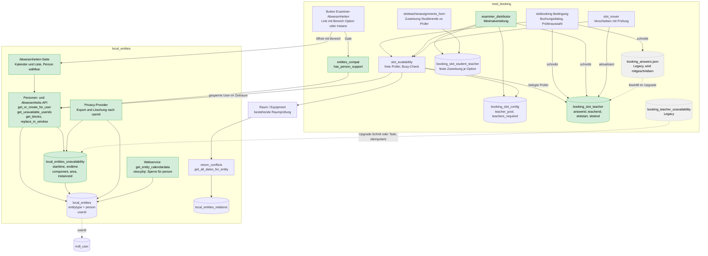
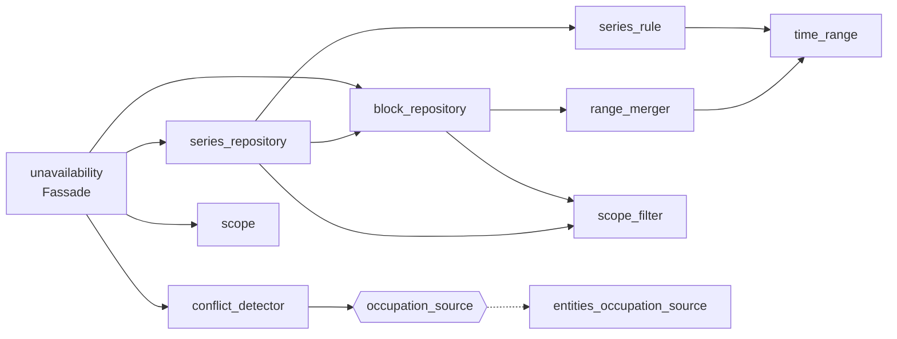

# Examiner-Verteilung — Zielarchitektur (local_entities + mod_booking)

> **Status:** Entwurf, Richtung mit Georg abgestimmt (2026-10-13). Detailentscheidungen pro Schritt
> werden im Umsetzungsplan (`EXAMINER_ENTITIES_IMPLEMENTATION_PLAN_2026-10-13.md`) einzeln besprochen.
> **Kontext:** IQSH-Ticket „Slot-Buchung mit Prüfer/innen" (Bezug #1318, #1390, #2320, #2231, #853).
> **Ist-Stand-Befunde** stammen aus einer Code-Durchsicht am 2026-10-13, nicht aus Laufzeittests.

---

## 1. Ziel

- Prüfer/innen (Moodle-User) tragen ihre Abwesenheiten selbst in einer einfachen Oberfläche ein.
- Slots sind nur buchbar, wenn genug freie Prüfer/innen aus dem Pool verfügbar sind.
- Vorhandene Prüfer/innen werden anhand von Slots und Verfügbarkeiten automatisch auf Buchende verteilt.
- Personen werden wie Ressourcen behandelt: **Typ `person` in `local_entities`**, Verteilung bleibt in `mod_booking`.

## 2. Zielarchitektur

Grün = neu, grau = bestehend, gestrichelt = Legacy bzw. Migration.

## 3. Verantwortlichkeiten

| Bereich | Gehört nach | Begründung |
|---|---|---|
| Person als Ressource, Abwesenheitszeiten, Konfliktlogik | `local_entities` | Konflikt- und Kalenderlogik existiert dort; Equipment ist der Präzedenzfall für Nicht-Ort-Typen. Auch für Räume nutzbar (Sperrungen). |
| Prüfer-Pool, `teachers_required`, Zuweisung Studierende ↔ Prüfer | `mod_booking` | Gehört zur Buchungsoption. Pool bleibt als User-IDs, Booking sieht keine Entity-IDs. |
| Slot ↔ Prüfer je Buchung (`booking_slot_teacher`) | `mod_booking` | Wahrheit der Buchung; abfragbar statt JSON-Scan. |
| Verteilungsalgorithmus | `mod_booking` | Braucht Slots, Antworten, Zuweisungen. |
| Oberfläche für Abwesenheiten (Kalender und Liste, Person wählbar, Bereich per Parameter) | `local_entities` | Prüfer tragen ihre Zeiten dort ein. Booking verlinkt nur mit vorbelegtem Bereich (Option oder Instanz). Die slotbezogene Seite `teacherunavailability.php` entfällt. |

## 4. Datenmodell (neu)

### `local_entities` (Änderung)

| Feld | Typ | Bemerkung |
|---|---|---|
| `entitytype` | char | neuer Wert `person` (bisher `location`, `equipment`) |
| `userid` | int, nullable, Index | nur bei `person`; Name wird nicht kopiert, sondern aus `user` aufgelöst |
| `allocationmode` / `maxconcurrent` | bestehend | Person-Default `exclusive` / `1` (Gruppenprüfung später über `maxconcurrent`) |

### `local_entities_unavailability` (neu)

| Feld | Bemerkung |
|---|---|
| `entityid` | FK auf `local_entities` |
| `starttime`, `endtime` | echte Zeitbereiche, unabhängig von der Slot-Konfiguration |
| `component`, `area`, `instanceid` | Geltungsbereich, siehe unten |
| `reason` | Grund (Spalte existiert heute schon in der Booking-Tabelle) |
| `timecreated`, `timemodified`, `usermodified` | Audit |

Indizes: `(entityid, starttime, endtime)` und `(component, area, instanceid)`.

Seit 2026-10-13 zusätzlich: Spalte `seriesid` (nullable, verweist auf `local_entities_unavail_series`).

### `local_entities_unavail_series` (neu, Zeitserien)

| Feld | Bemerkung |
|---|---|
| `entityid` | Person-Entity |
| `component`, `area`, `instanceid` | Geltungsbereich, wie bei den Terminen |
| `weekdays` | Wochentage der Wiederholung, kommagetrennt (1 = Montag bis 7 = Sonntag) |
| `allday` | 1 = ganztägig, sonst Uhrzeit von–bis |
| `daystart`, `dayend` | Sekunden seit Mitternacht, nur bei nicht ganztägig |
| `validfrom`, `validuntil` | Zeitraum der Serie (Tage) |
| `timezone` | Zeitzone, in der Wochentage und Uhrzeiten gelten (Zeitzone der Person) |
| `reason` | Grund |
| `timecreated`, `timemodified`, `usermodified` | Audit |

Die Termine einer Serie sind normale Zeilen in `local_entities_unavailability` mit gesetzter `seriesid`.
Serie bearbeiten ändert die Regel und erzeugt alle Termine der Serie neu. Termine verschiedener Serien
und Termine ohne Serie werden nie zusammengeführt.

**Geltungsbereich — ein Block gilt für Option X der Buchungsinstanz Y, wenn:**

- `component` leer (überall), oder
- `component=mod_booking, area=booking, instanceid=Y` (einmal je Buchungsinstanz), oder
- `component=mod_booking, area=option, instanceid=X`.

### `booking_slot_teacher` (neu, Booking)

| Feld | Bemerkung |
|---|---|
| `answerid`, `optionid` | Buchung und Option |
| `userid` | Teilnehmende Person |
| `teacherid` | Prüfer/in (Moodle-User) |
| `slotstart`, `slotend` | Slot-Zeitraum |

Index auf `(teacherid, slotstart, slotend)` und `answerid`. Pflege bei Buchen, Verschieben, Stornieren,
Nutzer- und Optionslöschung.

### Klassen der Abwesenheiten in `local_entities` (Stand 2026-10-14)

Die Abwesenheiten sind in kleine Klassen mit je einer Aufgabe aufgeteilt (Namensraum
`local_entities\unavailability\`). Die Klasse `local_entities\unavailability` ist nur noch eine dünne
**Fassade** mit stabilen statischen Methoden für andere Plugins und den Webservice.

| Klasse | Aufgabe | Muster |
|---|---|---|
| `scope` | Geltungsbereich (component/area/instanceid); ohne Komponente = überall | Value Object |
| `scope_filter` | SQL-Bedingung für Auswahl nach Scopes: alle / global plus Liste / genau einer | Specification |
| `time_range` | Zeitbereich mit Grund und Serien-ID, unveränderlich | Value Object |
| `range_merger` | Fasst überlappende oder angrenzende Bereiche gleicher Gruppe zusammen, ohne DB | reine Logik |
| `series_rule` | Prüft und normalisiert die Serienregel, berechnet die Tagesbereiche (Zeitzone, Zeitumstellung), ohne DB | Value Object |
| `block_repository` | Lesen, Ersetzen im Fenster, Einfügen und Entfernen einzelner Blöcke | Repository |
| `series_repository` | Serie anlegen, ändern, löschen, lesen; hält die Blöcke der Serie in Einklang | Repository |
| `occupation_source` | Schnittstelle: Belegungen einer Person liefern | Strategy |
| `entities_occupation_source` | Echte Quelle über die Service-Provider (live, ohne Cache) | Strategy (konkret) |
| `conflict_detector` | Findet Belegungen, die Zeitbereiche überlappen; bekommt die Quelle injiziert | Strategy-Nutzer |
| `unavailability` | Fassade für Aufrufer; übersetzt Array-Formate in Objekte | Facade |
| `unavailability_access` | Wer darf die Abwesenheiten welcher Entity pflegen: eigene Person immer, `manageunavailability` alle, `edit` Orte/Ausstattung; `can_open_page` für das Menü | Policy |
| `unavailability_changes` | Geprüfte Eingabe des Speicherns: neue Einzelblöcke, zu löschende Blöcke, Serien anlegen/ändern/löschen (max. 500) | Value Object |
| `unavailability_saver` | Speichern: Recht, Serien der Entity, Konflikte, dann alles in einer Transaktion; bei Konflikt wird nichts gespeichert | Application Service |
| `unavailability_reader` | Laden für die Seite (Blöcke und Serien eines Fensters, nur globale, max. 370 Tage) | Application Service |
| `manageable_entities` | Welche Entities darf der Betrachter wählen, nach Typ gruppiert | Query |
| `default_entity` | Welche Entity die Seite ohne `entityid` öffnet (eigene Person, sonst erste wählbare) | Service |
| `hook_callbacks` | Menüeintrag über `core_user\hook\extend_user_menu` | Hook-Callbacks |
| `external\get_unavailability`, `external\save_unavailability` | Webservices der Oberfläche, dünn | Adapter |
| `persons` | Person-Entity je Nutzer finden, anlegen (mit Schloss), Personen für eine Auswahl listen | Service |

Regeln für Erweiterungen: Neue Fachlogik bekommt eine eigene Klasse. Die Fassade enthält keine Logik.
Datenquellen für Konflikte werden über `occupation_source` angeschlossen (Booking kann später eine eigene
Quelle liefern, die auch unsichtbare Optionen sieht).

### JavaScript der Abwesenheiten-Seite (Stand 2026-10-19)

Die Oberfläche liegt als AMD-Module unter `local/entities/amd/src/unavailability/` (gebaut mit
`grunt amd --root=local/entities`). Module mit reiner Logik kennen weder Moodle noch das DOM und sind mit
Node getestet.

| Modul | Aufgabe | Art |
|---|---|---|
| `main` | Einstieg: lädt alle Texte mit einer Anfrage, startet Auswahl und Controller | Einstieg |
| `page_controller` | Verbindet Kalender, Änderungsliste, Speichern, Meldungen und Dialoge | Vermittler |
| `calendar_view` | Hülle um FullCalendar: zeigt Einträge an, meldet Auswahl und Klicks | Adapter |
| `event_builder` | Baut die Kalendereinträge aus Gespeichertem und Vorgemerktem, inkl. Tagesflächen | reine Logik |
| `pending_changes` | Änderungsliste (nur Neues und Geändertes), im Format des Webservice | reine Logik |
| `mark_planner` | Vereint einen markierten Zeitraum mit vorhandenen Einzelblöcken, Serientage bleiben | reine Logik |
| `range_math` | Abschneiden, Abziehen, Umrechnung zwischen Unix-Zeit und Eingabefeldern | reine Logik |
| `series_preview` | Vorschau der Tage einer Serienregel | reine Logik |
| `series_form` | Formular der Serie: Werte, Regel, Standardregel, Prüfung | reine Logik |
| `series_editor` | Entscheidet, welcher Dialog zu welchem Serien-Eintrag gehört, schreibt in die Änderungsliste | Vermittler |
| `entry_dialog`, `series_dialog`, `series_choice_dialog` | Dialoge: fragen nur und melden die Antwort | Dialog |
| `entity_select` | Durchsuchbare Entity-Auswahl (Moodle-Autocomplete) | Hülle |
| `api`, `message_area`, `html` | Webservice-Aufrufe, Meldungen (nur Text), HTML-Escaping | Hilfen |

Regeln der Oberfläche:

- **Nichts wird sofort gespeichert.** Neues erscheint orange schraffiert, Gespeichertes rot, Serientage mit
  dunklem Rand; erst „Speichern“ schreibt, mit Konfliktprüfung des Servers.
- **Vergangenes ist gesperrt:** Zeit vor heute 00:00 (Browser-Zeitzone) lässt sich weder markieren noch
  ändern; Blöcke, die vor heute beginnen, bleiben unverändert.
- **Ein Zeitraum, ein Block:** Ein markierter Zeitraum wird mit allen überlappenden oder angrenzenden
  Einzelblöcken zu einem Block vereint. Tage einer Serie werden nicht angefasst, dort wird nur das Freie
  aufgefüllt.
- **Ganze Tage** füllen zusätzlich die Tagesspalte (Hintergrundeintrag), „Bis“ zeigt den letzten Tag.
- **Serien:** eigener Knopf; ein Klick auf einen Serientag bietet „nur diesen Tag löschen“, „Serie
  bearbeiten“ und „Serie ab heute löschen“, jeweils mit Rückfrage beim Löschen.
- **Tests:** `local/entities/tests/js/run.sh` führt die Node-Tests in vier Zeitzonen aus (ein Loader bildet
  die Moodle-Importpfade auf die Quelldateien ab); PHP-Seite siehe PHPUnit-Dateien.

### Sichtbarkeit und Datenschutz (Stand 2026-10-19)

Eine Person ist personenbezogen. Die Regeln liegen in drei kleinen Klassen, die Seiten selbst enthalten
keine eigene Rechte-Logik.

| Klasse | Aufgabe | Muster |
|---|---|---|
| `person_visibility` | Wer darf eine Person als Entity sehen: nur die eigene Person und wer `local/entities:manageunavailability` hat; Orte und Ausstattung bleiben sichtbar; Gäste und Ausgeloggte sehen keine Person. Einzelprüfung (`can_see`, `can_see_id`) und SQL-Bedingung für Listen (`sql_condition`) | Policy, Specification |
| `privacy\user_data` | Findet, exportiert und löscht die Daten eines Benutzers: Person samt Abwesenheiten und Serien, von ihm angelegte Entities, von ihm zuletzt geänderte Abwesenheiten (bleiben, ohne seine ID) | Application Service |
| `privacy\provider` | Schnittstelle zur Moodle-Datenschutz-API (Metadaten, Kontexte, Benutzerliste, Export, Löschung), dünn über `user_data` | Adapter |
| `observer` | Beim Löschen eines Benutzers wird `user_data::erase` aufgerufen (`db/events.php`) | Adapter |

Wo `person_visibility` greift: Detailseite `view.php`, Druck-Kalender `calendar.php`, Bearbeiten-Seite
`edit.php` (nur bestehende Einträge), Webservice `get_entity_calendardata`, Admin-Tabelle in `entities.php`
und klassische Liste im Renderer. Eine unsichtbare Person verhält sich wie eine nicht existierende Entity
(gleiche Meldung), so verrät sich auch nicht, dass unter der Nummer eine Person steckt. Die Suche
(`search_entities`) liefert ohnehin nur Orte, die Auswahllisten in Booking nur Orte und Ausstattung.

## 5. Querschnittsregeln

1. **Gate:** Ohne `local_entities` mit Personen-API ist nur die Prüfer-Funktion („Prüfer zu Slots
   hinzufügen") nicht verfügbar. Slot-Buchung ohne Prüfer läuft weiter. `mod_booking` bekommt
   `local_entities` **nicht** in `dependencies`.
2. **Nur Sperrzeiten werden gespeichert und markiert.** Es gibt keinen Grün-Modus mehr. Positive Muster
   (z. B. wöchentliche Zeiten) kommen später über `openinghours`.
3. **Speichern ersetzt nur im sichtbaren Fenster** (`replace_in_window`), nie alle Blöcke einer Person.
4. **Sicherheit:** `get_entity_calendardata` und `view.php` sind heute öffentlich. Für `person` müssen
   sie sperren (Datenschutz), bevor Personen-Entities produktiv angelegt werden.
5. **Privacy:** Der Entities-Provider ist heute ein `null_provider`; mit `userid` muss er zu einem
   echten Provider werden. Booking entfernt die Tabelle `booking_teacher_unavailability` aus seinem.
6. **Migration:** idempotent, löscht erst nach erfolgreichem Kopieren; Legacy-Tabelle wird erst in einem
   späteren Release gelöscht.

## 6. Entscheidungen (getroffen)

| # | Entscheidung | Datum |
|---|---|---|
| D1 | Person als Typ in `local_entities` (Spalte `userid`), Verteilung bleibt in Booking | 2026-10-13 |
| D2 | `booking_teacher_unavailability` wandert samt Daten nach Entities, kein Fallback | 2026-10-13 |
| D3 | Prüfer-Funktion braucht Entities; Slot-Buchung ohne Prüfer läuft ohne | 2026-10-13 |
| D4 | Echte Zeitbereiche statt Slot-Fenster | 2026-10-13 |
| D5 | Instanz-Scope einmal je Buchungsinstanz referenziert | 2026-10-13 |
| D6 | Nur Sperrzeiten gespeichert; Grün-Modus entfällt (E-C, ersetzt die frühere Fassung „UI-Hilfe") | 2026-10-13 |
| D9 | Abwesenheiten-Oberfläche liegt in `local_entities`; Booking-Seite wird durch einen Link ersetzt | 2026-10-13 |
| D10 | Reihenfolge: sichtbare Entities-Schritte zuerst, Ist-Stand-Tests vor dem ersten Booking-Schritt | 2026-10-13 |
| D11 | Abnahme durch Sichtprüfung auf der lokalen Instanz und PHPUnit; kein Behat im Umbau | 2026-10-13 |
| D12 | Abwesenheiten-Seite: Kalender mit ganzen Tagen und Zeitfenstern, explizit speichern, Warnung bei ungespeicherten Änderungen | 2026-10-13 |
| D13 | Zeitserien mit Referenz: Serien-Tabelle mit Regel, Termine tragen `seriesid`; Bearbeiten und Löschen wirken ab heute 00:00 in der Serienzeitzone, die Vergangenheit bleibt, ein Block über Mitternacht wird gekürzt | 2026-10-14 |
| D14 | Konfliktschutz: Wer in dem Zeitraum als Prüfer einem Slot zugewiesen ist, kann dort keine Abwesenheit speichern | 2026-10-13 |
| D15 | Ersetzt durch D19 | 2026-10-13 |
| D16 | Architektur der Abwesenheiten: kleine Klassen mit je einer Aufgabe (Value Objects, Repositories, Strategy für Belegungsquellen), dünne Fassade, keine God-Klasse | 2026-10-14 |
| D17 | Konfliktregel: echte Überlappung (Berührung ist kein Konflikt), stornierte Termine zählen nicht, gilt für alle Scopes, Belegungen live ohne Cache | 2026-10-14 |
| D18 | Personenauswahl der Seite listet nur bestehende Personen (kein freier Nutzer-Suchdienst) | 2026-10-14 |
| D19 | Rechtemodell: die eigene Person darf ihre Abwesenheiten immer (als Person angelegt genügt, keine Rolle); `manageunavailability` öffnet alle Entities; `local/entities:edit` öffnet Orte und Ausstattung, nie Personen. Das Recht `manageownunavailability` entfällt | 2026-10-14 |
| D20 | Einstieg zur Seite über einen Eintrag im Nutzermenü (Hook `core_user\hook\extend_user_menu`) | 2026-10-14 |
| D21 | Eine Seite für alle Entities (`unavailability.php?entityid=X`), Oberfläche und Webservices kennen nur globale Abwesenheiten, Scopes von Booking folgen mit der Booking-Besprechung | 2026-10-16 |
| D22 | Speichern als Änderungsliste (nur Neues/Geändertes), nie „Fenster komplett ersetzen", damit Serienblöcke nicht verloren gehen | 2026-10-16 |
| D23 | Oberflächenregeln: Vergangenes gesperrt (ab heute 00:00 im Browser), markierte Zeiträume werden zu einem Block vereint, nichts doppelt; Serien über eigenen Knopf und Auswahldialog am Serientag | 2026-10-19 |
| D24 | Entity-Auswahl als eine durchsuchbare Liste (Autocomplete), der Typ steht im Text („Name (Typ)“); Wechsel öffnet die Seite der Entity | 2026-10-19 |
| D25 | Personen als Entity sind nur für die eigene Person und für `local/entities:manageunavailability` sichtbar (Listen, Detailseite, Druck-Kalender, Bearbeiten, Webservice); `local/entities:edit` öffnet sie nicht (wie bei D19) | 2026-10-19 |
| D26 | Eine unsichtbare Person verhält sich wie eine nicht existierende Entity, auch im öffentlichen Webservice und ausgeloggt | 2026-10-19 |
| D27 | Löschen eines Benutzers (Moodle oder Datenschutz-Werkzeug): Person-Entity samt Abwesenheiten und Serien wird gelöscht; was der Benutzer nur angelegt oder geändert hat, bleibt ohne seine ID (0) | 2026-10-19 |
| D7 | Ticket und Umbau in einem Zug, Frist wird verschoben | 2026-10-13 |
| D8 | Minimalversion der Verteilung gehört zur IQSH-Lieferung | 2026-10-13 |

## 7. Offene Punkte

| # | Frage | Wirkt auf |
|---|---|---|
| O1 | B3: Bei mehr Zugewiesenen als N — müssen alle frei sein oder nur N davon? | Verteilung, Buchungsdialog |
| O2 | B5: Teilen sich mehrere Prüflinge pro Slot die Prüfer (Gruppenprüfung)? `exclusive` vs. Kapazität | Busy-Check, `maxconcurrent` |
| O3 | Wer darf Abwesenheiten anderer pflegen (C5, Archetyp `teacher` hat `manageslotunavailability`)? | Capabilities in Entities |
| O4 | Benachrichtigung der Prüfer/innen bei Buchung (B4)? | Regeln/Events |
| O5 | Werden Prüfer/innen Trainer/innen des Termins (B6)? | Kalender, Rechte |
| O6 | Zeitzone in `date_within_openinghours` ist auf `Europe/Vienna` verdrahtet | nur relevant, wenn Öffnungszeiten für Personen genutzt werden |
| O7 | Wann kann ein Entities-Release mit Personen-API ausgerollt werden? | Reihenfolge Entities vor Booking |
| O8 | Eine Serie über vorhandenen Einzelblöcken erzeugt überlappende Blöcke (der Server vereint nur Blöcke derselben Serie). Beim Speichern serverseitig vereinen oder überspringen? | Serien-Speichern |
| O9 | Die Sprachdateien von FullCalendar werden nirgends geladen; Formate kommen über Intl, Texte über Moodle-Strings. Mit deutscher Oberfläche prüfen | Abnahme 3g |
| O10 | Wer nur `local/entities:edit` hat, kann eine Person anlegen (`edit.php?type=person`), sieht sie danach aber nicht. Anlegen ebenfalls an `manageunavailability` knüpfen? | Rechtemodell |
